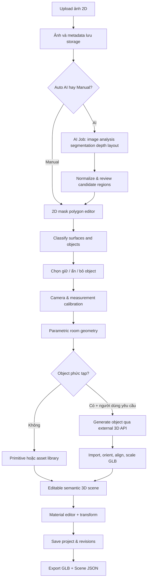
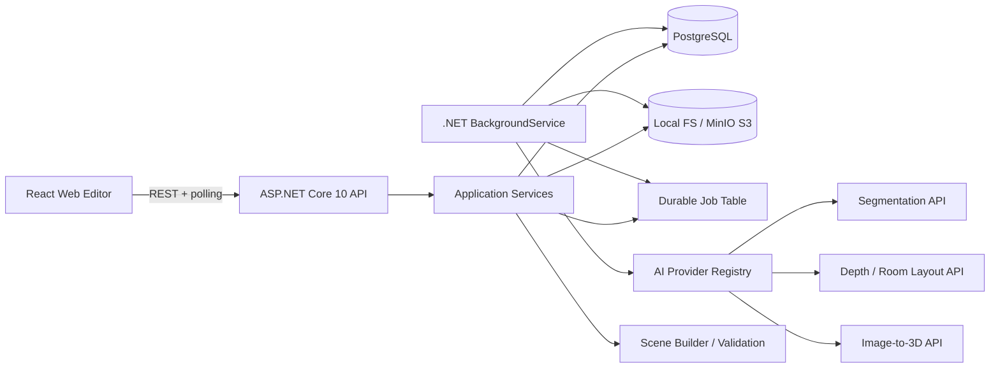
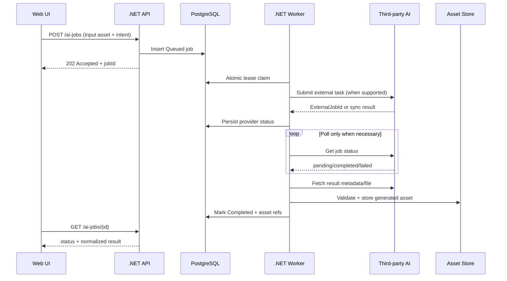
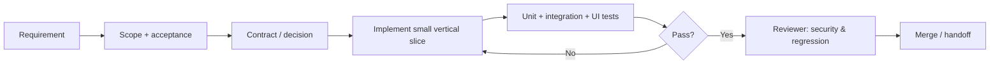

# ROOMFORGE AI — MASTER PRODUCT & ENGINEERING BLUEPRINT

> **Single source of truth** · Product spec + architecture + scene contract + AI integrations + agents + skills + workflows + phase prompts.
> **Status:** Implementation-ready planning document, **not** a claim that the application or AI integration already works.
> **Target:** Editable 3D rooms reconstructed approximately from 2D interior photos, optimized for material replacement.
> **Language:** Vietnamese specification; English copy/paste prompts for coding agents.
> **Core stack:** React + TypeScript + Three.js/R3F + ASP.NET Core 10 + PostgreSQL + third-party AI HTTP APIs.
> **Hard constraint:** No Python, FastAPI, PyTorch, self-hosted model inference, CUDA or local GPU dependency.

---

## MỤC LỤC

1. [Cách dùng tài liệu để bắt đầu](#1-cách-dùng-tài-liệu-để-bắt-đầu)
2. [Tầm nhìn và bài toán](#2-tầm-nhìn-và-bài-toán)
3. [Phạm vi MVP và tiêu chí thành công](#3-phạm-vi-mvp-và-tiêu-chí-thành-công)
4. [Workflow sản phẩm từ 2D tới 3D](#4-workflow-sản-phẩm-từ-2d-tới-3d)
5. [Kiến trúc hệ thống](#5-kiến-trúc-hệ-thống)
6. [Lựa chọn công nghệ và cấu trúc repository](#6-lựa-chọn-công-nghệ-và-cấu-trúc-repository)
7. [Thiết kế Semantic Scene Graph](#7-thiết-kế-semantic-scene-graph)
8. [Khôi phục không gian 3D và calibration](#8-khôi-phục-không-gian-3d-và-calibration)
9. [Material engine và 3D editor](#9-material-engine-và-3d-editor)
10. [AI Provider Abstraction, HTTP và async job](#10-ai-provider-abstraction-http-và-async-job)
11. [API contract và lưu trữ dữ liệu](#11-api-contract-và-lưu-trữ-dữ-liệu)
12. [UX/UI screens và behavior](#12-uxui-screens-và-behavior)
13. [Bảo mật, hiệu năng, chi phí và vận hành](#13-bảo-mật-hiệu-năng-chi-phí-và-vận-hành)
14. [AI Agents: vai trò và quy tắc phối hợp](#14-ai-agents-vai-trò-và-quy-tắc-phối-hợp)
15. [Skills: kích hoạt và nguyên tắc thực thi](#15-skills-kích-hoạt-và-nguyên-tắc-thực-thi)
16. [Development workflows và quality gates](#16-development-workflows-và-quality-gates)
17. [Roadmap theo phase, DoD và dependencies](#17-roadmap-theo-phase-dod-và-dependencies)
18. [MASTER PROMPT — copy vào coding agent](#18-master-prompt--copy-vào-coding-agent)
19. [Prompt chi tiết cho từng phase](#19-prompt-chi-tiết-cho-từng-phase)
20. [Prompt sử dụng hằng ngày và review](#20-prompt-sử-dụng-hằng-ngày-và-review)
21. [Checklist khởi tạo và quyết định còn mở](#21-checklist-khởi-tạo-và-quyết-định-còn-mở)

---

## 1. Cách dùng tài liệu để bắt đầu

**Mục tiêu:** chỉ cần thả **file này** vào một repository trống và yêu cầu coding agent đọc nó. Tài liệu đóng vai trò đồng thời là PRD, ADR nền tảng, kỹ thuật, quy tắc agent và bộ prompt triển khai. Không bắt buộc phải tạo `AGENTS.md`, nhiều skill hay agent files trước khi có code. Chúng có thể được **sinh ra từ tài liệu này** trong Phase 00, nhưng phải tránh copy ra những hướng dẫn mâu thuẫn.

**Quy trình khởi tạo:**

1. Tạo repository Git mới (hoặc mở repo trống hiện có).
2. Lưu file dưới tên `docs/ROOMFORGE_MASTER_BLUEPRINT.md`.
3. Đưa **MASTER PROMPT ở mục 18** vào Codex / Copilot Agent / Cursor hoặc coding agent tương đương.
4. Yêu cầu agent chạy **Phase 00 + Phase 01**, không nhảy trực tiếp vào AI.
5. Đọc báo cáo `build`, `test`, ảnh/screenshot UI nếu có, danh sách chức năng thực sự chạy và điểm chưa hoàn thành.
6. Khi phase đạt DoD, yêu cầu agent chạy prompt phase tiếp theo (mục 19).

**Nguyên tắc ưu tiên trong trường hợp xung đột:** yêu cầu mới nhất của người dùng > tài liệu này > codebase hiện hành > suy đoán của agent. Nếu đổi kiến trúc, cập nhật ngay tài liệu này và ghi nhận quyết định. Không tự suy ra vendor API, giá, license hay kích thước hình học thật.

**Kết quả đầu tiên phải nhìn thấy:** ảnh phòng mẫu được load vào màn hình editor, sàn/tường/tủ được render thành 3D, có thể chọn một bề mặt, đổi vật liệu, save vào API và reload mà không mất chỉnh sửa.

---

## 2. Tầm nhìn và bài toán

### 2.1 Bài toán thực tế

Người dùng chụp hoặc tải ảnh một căn phòng (phòng khách, phòng ngủ, bếp, cầu thang). Ứng dụng cần hỗ trợ:

- Nhận diện các **bề mặt cần thay vật liệu**: sàn, tường, mặt bàn, mặt kệ bếp, mặt bậc và cổ bậc cầu thang, mặt cánh tủ nếu phù hợp.
- Xác định **object**: tủ, bàn, giường, ghế, đảo bếp, đèn, cây; có thể chọn giữ, ẩn hoặc bỏ hẳn.
- Ước lượng chiều sâu, hình dạng, vị trí và kích thước từ ảnh; cho phép chỉnh tay theo **mốc đo thực tế**.
- Dựng một scene 3D có thể orbit/pan/zoom, select từng surface, gán vật liệu theo tỉ lệ thực và lưu lại.
- Generate mesh 3D cho những object phức tạp bằng **API AI của bên thứ ba**, không tự host model.
- Export GLB/JSON, lưu project để chỉnh sửa tiếp.

### 2.2 Giá trị sản phẩm

**Không tối ưu cho “photogrammetry perfect 3D”.** Hệ thống ưu tiên **Editable Approximate Semantic 3D**:

- **Semantic:** Biết đây là sàn, tường, kệ, ghế, mặt bàn… không chỉ là mesh vô danh.
- **Editable:** Mỗi mặt có SurfaceId, từng object có ObjectId, có resize/move/hide/material assignment.
- **Material-first:** Tỉ lệ gạch/đá và bề mặt được quan tâm hơn chi tiết trang trí ẩn bên ngoài góc chụp.
- **Human-in-the-loop:** AI đưa ra đề xuất; người dùng xác nhận hoặc sửa những gì AI không biết.
- **Provider-agnostic:** Thay API AI mà không phải thay kiến trúc ứng dụng.

### 2.3 Giả định và giới hạn bắt buộc

- Một ảnh 2D **không đủ** để xác định chính xác tất cả kích thước thật, vật thể bị khuất và hình học mặt sau.
- Monocular depth thường là độ sâu **tương đối**, không mặc nhiên là khoảng cách theo mét.
- Các API có thể chỉ trả `mesh`, `GLB`, `mask`, `depth map` hoặc metadata rời rạc; **không được giả định một provider có mọi capability**.
- Không được khẳng định kích thước là “measured” nếu chỉ do model suy đoán.
- Người dùng luôn phải có đường đi **manual-first**, kể cả khi API thất bại hoặc chưa có API key.
- Người dùng có thể loại bỏ đồ decor để xem rõ vật liệu; hide khác delete để có thể khôi phục.

---

## 3. Phạm vi MVP và tiêu chí thành công

### 3.1 In-scope MVP

1. CRUD project và upload ảnh có validation.
2. 3D editor với room shell mẫu, camera controls, lựa chọn surfaces/objects.
3. Bộ vật liệu: ảnh texture, repeat/rotation, width/height thực, roughness/metalness, preview.
4. Scene JSON có version, semantic IDs, world coordinates theo mét, save/load revision.
5. 2D annotation thủ công: polygon mask cho sàn/tường/mặt bàn, edit điểm và bỏ vùng sai.
6. Calibration bằng kích thước tham chiếu người dùng nhập.
7. Background job trên .NET và mock provider để chạy toàn bộ flow.
8. Tích hợp API thật cho **những capability mà provider được chọn hỗ trợ**.
9. Import từng object GLB nếu provider cung cấp, hoặc dùng parametric primitive fallback.
10. Visibility toggle, transform, undo/redo cơ bản; export scene JSON và GLB.

### 3.2 Out-of-scope ban đầu

- CAD/BIM chuẩn công nghiệp, bản vẽ thi công có sai số cam kết.
- Tự host 3D diffusion, GPU worker, fine-tuning AI model.
- Dựng hidden geometry hoàn hảo từ một góc ảnh.
- Real-time multi-user collaborative editor; marketplace vật liệu; thanh toán; mobile native.
- Texture synthesis hoặc PBR baking chuyên sâu (chỉ làm nếu nguồn API và workflow thật yêu cầu).

### 3.3 KPI kỹ thuật và nghiệm thu

| Chỉ tiêu | MVP acceptance |
|---|---|
| First-run | Docker infra + API + web chạy bằng README/hướng dẫn có lệnh cụ thể |
| Viewer | Load scene mẫu, orbit/pan/zoom, select floor/wall/countertop |
| Surface edit | Đổi vật liệu sàn không đổi tường, save/reload đúng |
| Coordinate | Meter, Y-up, XZ ground; geometry không đảo trục |
| Identity | ObjectId và SurfaceId không đổi qua save/load và material edits |
| Manual image→room | Annotation + calibration → scene gần đúng, chỉnh tay được |
| Async AI | Job có durable state; timeout, retry, refresh browser không làm mất job |
| AI provenance | Mọi đề xuất ghi nguồn `manual/mock/external/estimated/calibrated` |
| Export | JSON round-trip; GLB mở được bằng trình đọc glTF tương thích |
| Testing | Build backend/frontend thành công, unit/integration + E2E smoke |

> Accuracy của dựng 3D phải được đánh giá bằng sample phòng và độ chính xác của mốc đo thật; không tự đặt KPI “99% accurate reconstruction” vô căn cứ.

---

## 4. Workflow sản phẩm từ 2D tới 3D



### 4.1 Phân loại đối tượng và chiến lược dựng

| Category | Ví dụ | Strategy | AI cần thiết?  |
|---|---|---|---|
| `RoomSurface` | floor, wall, ceiling | Polygon/plane parametric geometry | Không bắt buộc |
| `ArchitecturalComponent` | stairs, counter, kitchen backsplash | Parametric mesh / extruded shape, material từng mặt | Không bắt buộc |
| `FurniturePrimitive` | cabinet, bed, dining table | Box/compound primitive, điều chỉnh dimension | Không bắt buộc |
| `GeneratedObject` | chair phức tạp, lamp, sofa | External image-to-3D API → GLB | Tùy chọn |
| `Decoration` | cây, bình hoa, phụ kiện | Ẩn/bỏ hoặc thư viện asset | Tùy chọn |

**Quy tắc:** Một mặt đá bếp nên là surface có thể thay vật liệu, không bị gộp chết vào texture của một mesh ghế/tủ phức tạp. Đối tượng AI generate khi nhập vào phải có `parentObjectId`, transform riêng, provenance và có thể hide/replace.

### 4.2 Khi AI không tìm đúng vật thể

- Người dùng vẽ/sửa polygon hoặc chọn region bằng point/box.
- Region có trạng thái `proposed`, `accepted`, `rejected`.
- Lưu provenance và confidence nếu vendor trả về; không tự chế confidence.
- Nếu depth/layout không hỗ trợ, dựng room shell từ thao tác thủ công và đặt placeholder primitives.

### 4.3 Các bước người dùng thực tế

1. Upload ảnh bếp.
2. Hệ thống trả danh sách vùng: sàn, tường A, backsplash, countertop, cabinet, ghế, đèn.
3. Chọn giữ kiến trúc, ẩn ghế/đèn; sửa region countertop nếu cần.
4. Nhập chiều rộng mặt bếp đã đo, ví dụ `2.4 m`, và xác nhận điểm/đoạn tương ứng trên ảnh.
5. Xem phòng 3D, chỉnh độ rộng, vị trí và hướng các object chưa đúng.
6. Chọn countertop, gán đá marble; chọn floor, gán gạch 600×600 mm.
7. Xoay camera, zoom để kiểm tra lát vật liệu; lưu revision; export.

---

## 5. Kiến trúc hệ thống



### 5.1 Quy tắc phụ thuộc

- `Domain` chứa entity, semantic scene, value objects, invariant; **không tham chiếu** HTTP, EF, Three.js, vendor DTO.
- `Application` chứa use cases, abstraction `IAiProvider`, `IAssetStore`, `ISceneRepository`, orchestration.
- `Infrastructure` chứa EF Core, HTTP typed clients, S3 adapter, background job processor.
- `Api` chứa endpoints, auth/policies, validation, DI, HTTP responses, webhooks (nếu có).
- `Web` có state editor và renderer; chỉ nói chuyện với `Api`, không dùng AI secret.

### 5.2 Tiến trình chạy ban đầu

- **Process 1:** ASP.NET Core API với hosted `BackgroundService` (MVP), DB-persisted jobs.
- **Process 2:** React dev server / static web frontend.
- **Services:** PostgreSQL; MinIO khi cần S3, hoặc local filesystem cho dev cực nhanh.
- Khi job nhiều, tách `RoomForge.Worker` thành process riêng mà **không đổi domain/application contract**.
- Chưa cần RabbitMQ, Redis, Kubernetes, event bus. Chỉ thêm sau khi thấy bottleneck thật.

### 5.3 Những phần bắt buộc có interface

- `IImageAnalysisProvider`
- `ISegmentationProvider`
- `IDepthProvider`
- `IRoomLayoutProvider`
- `IImageTo3DProvider`
- `IAiProviderRegistry`
- `IAssetStorage`
- `ISceneRepository`
- `IJobRepository`
- `ISceneReconstructionService`
- `ISceneExportService`

**Lưu ý:** một vendor không nhất thiết implement hết. Chọn provider theo capability; thiếu capability thì báo unsupported và chuyển sang manual fallback.

---

## 6. Lựa chọn công nghệ và cấu trúc repository

### 6.1 Stack đã chốt

| Module | Stack |
|---|---|
| Web | React, TypeScript, Vite |
| 3D render | Three.js, React Three Fiber, Drei |
| 2D annotation | React Konva / Konva |
| State/data | Zustand (editor ephemeral), TanStack Query (server cache), Zod (runtime validation) |
| Styling | Tailwind CSS hoặc CSS Modules, lựa chọn một hướng nhất quán |
| Backend | ASP.NET Core 10 Web API + C# |
| ORM/DB | EF Core 10 + PostgreSQL |
| AI HTTP | `IHttpClientFactory`, typed clients, resilience policies |
| Background jobs | Durable PostgreSQL job table + .NET BackgroundService |
| Storage | Local development filesystem; S3-compatible adapter (MinIO / cloud) |
| Tests | xUnit, WebApplicationFactory, Vitest, Playwright smoke |
| Containerization | Docker Compose cho DB/storage/dev integration |
| Export | glTF 2.0 / GLB + versioned Scene JSON |

### 6.2 Repository structure (target)

```text
roomforge-ai/
├─ docs/
│  └─ ROOMFORGE_MASTER_BLUEPRINT.md      # source of truth (this file)
├─ apps/
│  └─ web/
│     ├─ src/
│     │  ├─ app/
│     │  ├─ features/projects/
│     │  ├─ features/image-annotation/
│     │  ├─ features/room-editor/
│     │  ├─ features/material-library/
│     │  ├─ features/ai-jobs/
│     │  ├─ engine/scene/
│     │  ├─ engine/geometry/
│     │  ├─ engine/materials/
│     │  ├─ engine/interaction/
│     │  ├─ api/
│     │  ├─ state/
│     │  └─ components/ui/
│     ├─ public/fixtures/
│     └─ package.json
├─ src/
│  ├─ RoomForge.Api/
│  ├─ RoomForge.Application/
│  │  ├─ Projects/
│  │  ├─ Scenes/
│  │  ├─ AiJobs/
│  │  └─ AI/Contracts/
│  ├─ RoomForge.Domain/
│  │  ├─ Scenes/
│  │  ├─ Projects/
│  │  └─ Assets/
│  ├─ RoomForge.Infrastructure/
│  │  ├─ Persistence/
│  │  ├─ Storage/
│  │  ├─ AI/Providers/
│  │  └─ Jobs/
│  └─ RoomForge.slnx
├─ tests/
│  ├─ RoomForge.UnitTests/
│  ├─ RoomForge.IntegrationTests/
│  └─ web-e2e/
├─ examples/
│  ├─ sample-scene.json
│  └─ fixtures/
├─ .agents/skills/                       # OPTIONAL: generate from §15
├─ .github/agents/                       # OPTIONAL: generate from §14
├─ .github/workflows/
├─ docker-compose.yml
├─ .env.example
├─ .gitignore
└─ README.md
```

### 6.3 Quy tắc code

- Back-end dùng vertical slices/use-case oriented application services, không dựng hàng loạt repository abstraction không cần thiết.
- `SceneDocument` có schema version rõ ràng, JSON serialize và validate tại boundary.
- API công bố OpenAPI; client được type-safe qua generated types hoặc DTO consistency tests.
- TypeScript `strict: true`. C# nullable enabled, cảnh báo cần xử lý, không bỏ toàn bộ warnings.
- DTO của vendor **chỉ ở Infrastructure**, map sang internal result trong Application.
- Không tạo placeholder UI giả hoạt động; thiếu chức năng thì disable và giải thích rõ.

---

## 7. Thiết kế Semantic Scene Graph

### 7.1 Quy ước hình học bất biến

- **Đơn vị:** meter (`m`) trong SceneDocument; material tile size cũng meter.
- **Hệ trục:** right-handed, `+Y` hướng lên, sàn nằm trên mặt phẳng `XZ` với `Y=0`.
- `+X`: chiều ngang phòng, `+Z`: chiều sâu phòng theo world coordinate; camera có thể tùy hướng nhưng không đổi trục scene.
- Transform gồm `position` (m), `rotation` (quaternion `[x,y,z,w]`), `scale` (unitless).
- Kích thước physical geometry không nhét ngầm trong transform scale; một primitive có dimensions riêng.
- ID là UUID ổn định qua save/load; geometry rebuild không được làm mất `surfaceId`.
- Frontend engine có mapping rõ từ semantic surfaces đến mesh/face. Nếu top/side material riêng, geometry phải hỗ trợ material groups hoặc meshes riêng.

### 7.2 Canonical entities

| Entity | Trường cốt lõi |
|---|---|
| `Project` | id, name, createdBy, createdAt, updatedAt, activeSceneId |
| `SourceImage` | id, projectId, assetId, pixelWidth/Height, EXIF orientation |
| `SceneDocument` | schemaVersion, sceneId, revision, units, coordinateSystem, room, objects, materials, annotations, calibration |
| `SceneObject` | objectId, semanticType, label, parentId, transform, geometry, visible, source |
| `Surface` | surfaceId, objectId, semanticRole, materialId, geometryFaceRef, editable |
| `MaterialDefinition` | materialId, PBR channels, tileWidthMeters, tileHeightMeters, rotationDeg |
| `Annotation` | regionId, imageId, polygon/mask ref, label, reviewStatus, source |
| `Calibration` | anchors (known metric length + image endpoints), assumptions, quality flag |
| `Asset` | assetId, contentType, sha256, storageKey, size, source |
| `ProcessingJob` | jobId, type, state, provider, providerJobId, attempt, timestamps, resultAssetIds |

### 7.3 SceneDocument JSON ví dụ (hợp lệ về cấu trúc, số đo **chỉ là fixture**)

```json
{
  "schemaVersion": "1.0.0",
  "sceneId": "a1111111-1111-4111-8111-111111111111",
  "revision": 1,
  "units": "m",
  "coordinateSystem": "right-handed-y-up-xz-floor",
  "sourceImageId": "b2222222-2222-4222-8222-222222222222",
  "calibration": {
    "status": "uncalibrated",
    "anchors": [],
    "notes": "Sample dimensions are illustrative, not inferred from a photo"
  },
  "materials": [
    {
      "materialId": "c3333333-3333-4333-8333-333333333333",
      "name": "Light marble floor",
      "baseColor": "#dfdfda",
      "baseColorTextureAssetId": null,
      "normalTextureAssetId": null,
      "roughnessTextureAssetId": null,
      "metalness": 0.0,
      "roughness": 0.6,
      "tileWidthMeters": 0.6,
      "tileHeightMeters": 0.6,
      "textureRotationDeg": 0
    }
  ],
  "objects": [
    {
      "objectId": "d4444444-4444-4444-8444-444444444444",
      "parentObjectId": null,
      "semanticType": "RoomSurface",
      "label": "Floor",
      "visible": true,
      "transform": {
        "position": [0, 0, 0],
        "rotation": [0, 0, 0, 1],
        "scale": [1, 1, 1]
      },
      "geometry": {
        "kind": "plane",
        "widthMeters": 4.0,
        "depthMeters": 3.5,
        "facing": "+y"
      },
      "surfaces": [
        {
          "surfaceId": "e5555555-5555-4555-8555-555555555555",
          "semanticRole": "floor.finish",
          "faceRef": "top",
          "editable": true,
          "materialId": "c3333333-3333-4333-8333-333333333333"
        }
      ],
      "provenance": {"source": "fixture", "confidence": null}
    }
  ]
}
```

**Important:** `faceRef: top` là semantic contract; renderer quyết định tạo plane/mesh sao cho normal và UV đúng. SceneDocument không lưu raw Three.js object instance; chỉ lưu dữ liệu độc lập renderer.

### 7.4 Scene changes, revision và undo/redo

- Client thực hiện commands như `AssignSurfaceMaterial`, `SetObjectTransform`, `SetVisibility`, `AddAnnotation`, `UpdateCalibration`.
- Undo/redo ban đầu dùng command history trong web editor. Sau refresh, dựa vào revisions lưu trên server.
- API save có `expectedRevision` hoặc ETag/If-Match; `409 Conflict` khi ghi đè revision đã cũ.
- Mỗi lần save tạo revision metadata; có thể giới hạn history retention. Không dùng image-to-3D output GLB làm dữ liệu chính.
- `hide` object giữ object ID và transform; `delete` là hành vi riêng có confirmation hoặc undo.

---

## 8. Khôi phục không gian 3D và calibration

### 8.1 Phân biệt 3 nguồn dữ liệu

| Source | Ý nghĩa | Độ tin cậy |
|---|---|---|
| `manual_measured` | Chiều dài thật do người dùng nhập | Cao nếu người dùng đo đúng |
| `external_estimated` | AI ước lượng depth/layout/bounding boxes | Phụ thuộc model, có thể sai |
| `inferred_geometry` | Hình học parametric khớp annotation/constraint | Chỉ gần đúng |

Các trường kích thước cần có `value`, `unit`, `source`, optional `confidence`, `anchorIds`, `reviewed` để UI phân biệt số đo thực và ước lượng.

### 8.2 Các bước xây room shell

1. **Normalize ảnh:** EXIF orientation, width/height pixel, giữ aspect ratio, không bóp méo.
2. **Region detection:** AI hoặc manual polygon cho sàn/tường/ceiling/countertop, masks được lưu riêng.
3. **Room layout:** tìm corners, edges, vanishing points / candidate planes khi có; hỗ trợ người dùng sửa.
4. **Camera estimate:** gần đúng camera FOV/pose từ layout/depth (nếu đủ tín hiệu), hiển thị trạng thái estimated.
5. **Scale calibration:** người dùng kéo đoạn tham chiếu trên ảnh và nhập chiều dài thật, ví dụ 2.4 m; áp dụng tới geometry có ràng buộc hợp lệ, không nhân bừa depth tương đối.
6. **Parametric geometry:** dựng floor polygon, wall planes, cabinet/countertop/stairs theo primitives.
7. **Spatial placement:** đặt object dựa trên floor contact, relative depth, layout constraints; cho phép edit.
8. **Validation:** không có NaN/negative dimensions, geometry không lật, normal/UV hợp lý, bounds trong scene.
9. **Review:** ghi nhận unknown/hypothesized regions và các vấn đề cần xác nhận.

### 8.3 Chiến lược fallback an toàn

- Không có depth → đặt object theo tương quan 2D và thao tác thủ công.
- Không có camera calibration → hiển thị default room + thao tác điều chỉnh perspective/camera.
- Không có mesh AI → primitive box, cylinder hoặc asset library.
- Object ẩn phía sau ảnh → **không generate tùy tiện như sự thật**; dùng minimal inferred geometry và đánh dấu approximate.
- Ảnh có góc rộng/ống kính méo → cảnh báo và cho hiệu chỉnh thủ công.

### 8.4 Thước đo đúng cho sản phẩm

Cần ưu tiên **surface accuracy + editability + reasonable spatial consistency** thay vì chamfer distance/mesh similarity thuần túy. Test thực tế: chọn mặt đá bếp, thay vật liệu đúng mặt, kích thước gạch theo mét và có thể nhìn ở nhiều góc.

---

## 9. Material engine và 3D editor

### 9.1 Những tính năng tối thiểu

- Chọn object bằng raycasting, sau đó chọn **surface** cụ thể.
- Highlight surface được chọn, inspector hiển thị semantic label, ID, kích thước, material đang dùng.
- Material library có thumbnail, name, type (tile/wood/stone/paint), color, optional maps.
- Gán/chỉnh material với `baseColor`, `roughness`, `metalness`, normal map, roughness map khi có.
- Tỉ lệ gạch theo kích thước thực `tileWidthMeters`, `tileHeightMeters`; texture UV được tính theo kích thước mặt và hướng cục bộ (không chỉ `repeat(1,1)`).
- Các thuộc tính `offset`, `rotation`, `repeat`, `groutWidth`, `groutColor` nên là optional v1/v2 tùy độ phức tạp.
- Hide/show/remove object; move/rotate/scale với transform gizmo, snapping tùy chọn.
- Orbit/pan/zoom; reset camera; chọn Top/Front/Perspective; grid toggles.
- Undo/redo; autosave có debounce + manual Save; cảnh báo unsaved changes.

### 9.2 Surface-level editing khó ở đâu?

Một mesh import từ vendor có thể đã **gộp nhiều vùng** trong một geometry/material. Đổi texture trên toàn mesh sẽ làm sai mục tiêu. Giải pháp theo thứ tự ưu tiên:

1. Dùng primitives/parametric mesh riêng cho kiến trúc, gán material bằng SurfaceId.
2. Khi imported GLB có material groups rõ ràng, map groups sang semantic SurfaceId có thể chọn.
3. Nếu GLB chỉ có một mesh/texture, không hứa sửa vật liệu từng face; hoặc tách mesh sau bước segmentation/mesh processing có kiểm tra, hoặc thay bằng primitive proxy cho bề mặt cần xử lý.

### 9.3 Texture, URL và dữ liệu không tin cậy

- Texture upload cần kiểm MIME, max size, giới hạn pixel dimensions, lưu asset nội bộ.
- Imported GLB phải có giới hạn size, polygon count, texture count, validate format, tránh remote external asset references không kiểm soát.
- Rendering giữ base geometries hợp lý; dispose geometry/material/texture tránh leak WebGL.

---

## 10. AI Provider Abstraction, HTTP và async job

### 10.1 Thực tế của bên thứ ba

Chỉ tích hợp provider bằng tài liệu API chính thức mà chủ dự án chọn. Cần xác nhận rõ: input (public/private image URL hoặc multipart), output (URL, GLB/OBJ, image masks, JSON), auth, task status/webhook, retention, quyền thương mại, cost/rate limits. **Không đoán endpoint hay payload.**

### 10.2 Capability matrix (mẫu để điền sau)

| Capability | Candidate provider | Output được xác minh? | Fallback |
|---|---|---|---|
| Image understanding | TBD | No | Manual label |
| Segmentation / mask | TBD | No | Polygon annotation |
| Depth estimation | TBD | No | Manual layout/position |
| Room layout | TBD | No | Room shell builder |
| Image → 3D object | TBD | No | Primitive / asset library |
| GLB output | TBD | No | Validated converter nếu thật sự cần |
| Async job + polling | TBD | No | Provider-specific sync adapter (chỉ khi hỗ trợ) |
| Signed webhook | TBD | No | Polling |

**Quy tắc:** `image-to-3D` không đồng nghĩa `room reconstruction`. Nếu vendor trả 1 GLB “dính cục” của toàn phòng, chưa chắc đáp ứng được chỉnh sửa từng sàn/tường/mặt bếp. Nên ưu tiên provider nhận masked object image / crop và có output per-object, hoặc tách architecture surfaces thành primitives.

### 10.3 Internal C# contracts (illustrative, vendor-neutral)

```csharp
public enum AiCapability
{
    ImageAnalysis,
    Segmentation,
    DepthEstimation,
    RoomLayout,
    ImageTo3D
}

public record AiSubmission(
    string Provider,
    string? ExternalJobId,
    bool CompletedSynchronously,
    string? InternalResultAssetId);

public interface IImageTo3DProvider
{
    string ProviderKey { get; }
    Task<AiSubmission> SubmitAsync(
        GenerateObject3DRequest request,
        CancellationToken cancellationToken);
    Task<AiJobStatus> GetStatusAsync(
        string externalJobId,
        CancellationToken cancellationToken);
    Task<GeneratedAssetResult> GetResultAsync(
        string externalJobId,
        CancellationToken cancellationToken);
}

public interface ISegmentationProvider
{
    string ProviderKey { get; }
    Task<SegmentationResult> SegmentAsync(
        SegmentImageRequest request,
        CancellationToken cancellationToken);
}
```

**Chú thích:** các DTO trên là bản vẽ contract, cần triển khai đủ kiểu theo use-case thực tế. Provider async/sync phải được normalize và có một đường xử lý job thống nhất.

### 10.4 Durable job state machine

```text
Queued
  → Claimed
  → SubmittedToProvider
  → WaitingForProvider
  → FetchingResult
  → ValidatingAsset
  → Completed

Any active state → RetryScheduled → Claimed
Any active state → Failed
Queued/Waiting... → CancelRequested → Cancelled (when possible)
```

State persisted trong Postgres: `JobId`, `ProjectId`, `Kind`, `ProviderKey`, `ExternalJobId`, `IdempotencyKey`, `AttemptCount`, `LeaseOwner`, `LeaseUntil`, `NextRunAt`, `ErrorCode`, `ResultAssetIds`, timestamps. Có concurrency token/atomic claim; restart service không mất job.

### 10.5 Async sequence



### 10.6 Failure/retry rules

- HttpClient factory + typed clients; server-side provider API keys only.
- Explicit timeouts, CancellationToken, rate limiting, quota and `Retry-After` for 429.
- Transient 5xx/network → exponential backoff + jitter. Bad input/401/403 → fail with clear actionable error.
- **Không tự retry paid submit** khi không biết request cũ đã thành công hay chưa: reconcile bằng external job ID / idempotency feature nếu provider hỗ trợ.
- Verify webhook signature nếu dùng webhook. Chống replay và duplicate completion.
- Download signed result URLs có allowlist host/SSRF protection, no arbitrary redirect, max bytes, hash, MIME magic detection.
- Provider result gồm `source`, `model` (nếu được cung cấp), `providerJobId`, `rawResponseAssetId` (private), `confidence` nếu vendor cung cấp.
- Track `estimatedCost`, `actualCost` nếu provider trả về, quota per project/user và global throttle.

### 10.7 API secrets example (KHÔNG commit secret)

```text
AI__DefaultImageTo3DProvider=provider-a
AI__Providers__ProviderA__BaseUrl=https://official-provider-url.example
AI__Providers__ProviderA__ApiKey=<use environment or dotnet user-secrets>
Storage__Mode=Local
```

`.example` trên chỉ minh họa tên setting; **không phải endpoint thật**. Production lấy từ env/secret store. UI chỉ thấy provider name/capabilities/status phù hợp.

---

## 11. API contract và lưu trữ dữ liệu

### 11.1 Endpoints (gợi ý chuẩn hóa)

| Method | Route | Kết quả |
|---|---|---|
| `POST` | `/api/projects` | Tạo project |
| `GET` | `/api/projects` | Danh sách project |
| `GET` | `/api/projects/{id}` | Project detail |
| `POST` | `/api/projects/{id}/images` | Upload ảnh / metadata |
| `GET` | `/api/projects/{id}/scenes/current` | Current SceneDocument |
| `PUT` | `/api/projects/{id}/scenes/current` | Save scene với expectedRevision |
| `GET` | `/api/projects/{id}/scenes/revisions` | Revision history |
| `POST` | `/api/projects/{id}/annotations` | Create annotation |
| `PUT` | `/api/projects/{id}/annotations/{annotationId}` | Update mask/polygon |
| `GET` | `/api/materials` | Material library |
| `POST` | `/api/materials` | Tạo material/texture refs |
| `GET` | `/api/ai/providers/capabilities` | Provider capabilities được cấu hình |
| `POST` | `/api/projects/{id}/ai-jobs` | 202 + jobId |
| `GET` | `/api/ai-jobs/{jobId}` | State + result refs |
| `POST` | `/api/ai-jobs/{jobId}/cancel` | Request cancellation |
| `POST` | `/api/projects/{id}/exports` | Export JSON/GLB (sync/async tùy size) |
| `GET` | `/api/projects/{id}/exports/{exportId}` | Download / status |

Chốt ID/tên endpoint bằng OpenAPI trong Phase 01, sau đó đồng bộ frontend. Không gắn UI cố định với cấu trúc JSON của AI provider.

### 11.2 Error contract

Dùng `ProblemDetails` theo HTTP semantics, fields `type`, `title`, `status`, `detail`, `traceId`, optional `code`, `validationErrors`. Không trả secrets/raw provider exceptions. Với stale scene revision trả `409` cùng current revision metadata.

### 11.3 DB schema gợi ý

```text
Projects(Id, Name, OwnerId?, ActiveSceneId?, CreatedAt, UpdatedAt)
Assets(Id, ProjectId, StorageKey, ContentType, ByteSize, Sha256, CreatedAt)
SourceImages(Id, ProjectId, AssetId, PixelWidth, PixelHeight, CreatedAt)
SceneRevisions(Id, ProjectId, RevisionNo, SchemaVersion, DocumentJson,
               BasedOnRevisionNo, CreatedAt)
ImageAnnotations(Id, ProjectId, SourceImageId, RegionId, Label, GeometryJson,
                 Status, ProvenanceJson, UpdatedAt)
Materials(Id, ProjectId?, Name, DefinitionJson, CreatedAt)
ProcessingJobs(Id, ProjectId, JobType, ProviderKey, Status, ExternalJobId,
               IdempotencyKey, AttemptCount, LeaseUntil, NextRunAt,
               InputJson, ResultJson, LastErrorCode, CreatedAt, UpdatedAt)
Exports(Id, ProjectId, SceneRevisionNo, Status, AssetId?, CreatedAt)
```

- Với MVP, `SceneRevisions.DocumentJson` là canonical state; nếu dùng `jsonb`, thêm index khi có query cụ thể.
- `Assets` chỉ lưu metadata; binary ở object storage.
- Job claim dùng atomic update/transaction, multi-process safe.
- Index tối thiểu: `(ProjectId, RevisionNo)` unique, `ProcessingJobs(Status, NextRunAt)`, `Assets(ProjectId)`, `IdempotencyKey` unique khi scope hợp lệ.

### 11.4 Scene save request ví dụ

```json
{
  "expectedRevision": 5,
  "document": {
    "schemaVersion": "1.0.0",
    "sceneId": "a1111111-1111-4111-8111-111111111111",
    "revision": 5,
    "units": "m",
    "coordinateSystem": "right-handed-y-up-xz-floor",
    "sourceImageId": null,
    "calibration": {"status": "uncalibrated", "anchors": []},
    "materials": [],
    "objects": []
  }
}
```

Server validate `expectedRevision == latestRevision`, tăng revision phía server thành 6, và trả document mới. Client không tự coi request thành công nếu chưa nhận response.

---

## 12. UX/UI screens và behavior

### 12.1 Thiết kế Editor

- **Header:** logo RoomForge, project name, Save state, Undo/Redo, Export.
- **Left panel:** Project assets, scene hierarchy, object visibility/lock; tab ảnh 2D/Annotations.
- **Center:** 3D viewport lớn, camera orbit, scene grid, selection highlight, gizmo, camera presets.
- **Right panel:** Inspector cho selected object/surface, dimensions, transform, calibration và Material picker.
- **Bottom rail (tùy chọn):** AI Jobs (queued/running/failed/ready), thumbnail assets, history.
- **Progress:** AI job rõ trạng thái, không có nút “Generate” giả. Chỉ enable capability đã được cấu hình.

### 12.2 UI design principles

- Professional 3D tool: ít màu chói, phân cấp thị giác tốt, bảng điều khiển gọn, typography rõ ràng.
- Dark/neutral default phù hợp viewport (có thể thêm light mode sau).
- Actions quan trọng hiển thị ngay: select face, change material, input dimensions, hide/remove.
- Không lạm dụng gradient, glassmorphism, neon “AI dashboard”.
- Empty state hướng dẫn upload ảnh hoặc load sample room; error state có Retry/manual fallback.
- Có loading states, job cost hint nếu có dữ liệu, toast save success/failure.
- Keyboard shortcuts: `Ctrl+S` save, `Ctrl+Z/Y` undo/redo, `Del` remove sau confirm (tùy), `Esc` clear selection.

### 12.3 Screens MVP

1. Projects dashboard.
2. Project creation/upload image.
3. 2D annotation and calibration panel.
4. 3D material editor (core screen).
5. Material library/upload texture.
6. AI jobs and generated assets viewer.
7. Export modal.

### 12.4 Behavior cần test

- Chọn surface sàn bằng click không chọn nhầm wall khi giao nhau.
- Đổi vật liệu không làm mất original mesh hoặc ID.
- Tắt visibility của chair không xóa dữ liệu; restore được sau reload.
- Nhập kích thước không hợp lệ → validation rõ ràng, không làm scene crash.
- Chuyển từ 2D sang 3D giữ mapping region → semantic object.
- UI vẫn dùng được khi AI quota hết hoặc provider offline.

---

## 13. Bảo mật, hiệu năng, chi phí và vận hành

### 13.1 Security checklist

- AI keys và object storage credentials chỉ ở backend; không commit `.env` chứa secret.
- Upload whitelist JPG/PNG/WebP được hỗ trợ, size/pixel limits, validate content bytes.
- Không fetch URL bên ngoài do client cung cấp nếu chưa kiểm soát SSRF, redirects, private IP và DNS rebinding.
- Không expose signed URLs quá lâu; scope theo asset và expiry.
- Object-level authorization: một project user không được truy cập asset/job của project khác.
- Webhook endpoint validate signatures và anti-replay; rate limit.
- Logging structured, redact image URLs chứa token, API keys, headers và PII.
- Kiểm tra quyền sử dụng thương mại, privacy/retention của vendor trước khi gửi ảnh nội thất khách hàng.

### 13.2 Performance

- Render primitives đơn giản trước. GLB generated chỉ load khi bật và được import.
- Asset compression / optimized texture sizes / mipmaps, lazy-load large GLB.
- Scene JSON nên nhỏ, dùng asset reference thay vì nhúng base64.
- Dispose WebGL resources khi đổi scene/material/asset.
- Worker concurrency được giới hạn theo provider quota và phí.
- Job polling UI dùng backoff; ưu tiên tối ưu UX thay vì polling liên tục.

### 13.3 Cost control

- Mặc định **không generate 3D cho tất cả object**. Chọn object quan trọng rồi mới gọi paid API.
- Trước job hiển thị provider, tác vụ, ước lượng chi phí **nếu có nguồn chính xác**; nếu chưa có thì báo unknown.
- Khuyến khích cache theo content SHA256 + provider + model + params + version; cần consent/policy phù hợp.
- Tài liệu privacy và retention là điều kiện trước khi dùng ảnh thật của khách hàng.
- Theo dõi request count, latency, failure rate, successful outputs, duplicate paid submits.

### 13.4 Dev environment

- `.NET SDK 10`, `Node.js LTS` tương thích với Vite được chọn, Docker + Docker Compose.
- Lệnh setup được agent cập nhật theo files thực tế trong README, không hardcode lệnh sai path.
- `dotnet user-secrets` cho local secrets; `.env.example` chỉ gồm placeholder không nhạy cảm.
- `docker compose` dùng PostgreSQL và MinIO khi cần, migration chạy riêng có kiểm soát.

---

## 14. AI Agents: vai trò và quy tắc phối hợp

**Tài liệu này chứa đầy đủ định nghĩa vai trò.** Nếu coding platform hỗ trợ sub-agents, Phase 00 có thể sinh `.github/agents/*.agent.md` hoặc agent config phù hợp từ phần này. Nếu không, dùng *một coding agent* đổi vai trò qua prompt. Không cần giả định multi-agent luôn khả dụng.

| Agent | Sở hữu | Đầu vào | Đầu ra cần bàn giao | Không được làm |
|---|---|---|---|---|
| **Architect / Orchestrator** | Decisions, phase plan, boundaries, integration | Goal, file, current repo | ADR notes, scoped tasks, final integration report | Gọi các phase sau khi chưa xong DoD |
| **Frontend & 3D Engineer** | React UI, viewer, selection, material engine | Scene contract, UI spec | Real editor flow, tests/screenshots | Gọi vendor AI trực tiếp từ browser |
| **Geometry Engineer** | Parametric mesh, camera, calibration, transforms | Annotation, semantic scene | Geometry builders, coordinate tests | Khẳng định metric dimensions không có anchor |
| **Backend Engineer** | .NET API, EF, storage, scene persistence | API contract | API, migrations, tests | Nhét vendor DTO vào domain |
| **AI Integration Engineer** | HTTP adapters, job orchestration, result validation | Official vendor docs + credentials via secrets | Typed provider, fixture tests, status mappings | Bịa API endpoint/payload/cost |
| **QA / Security Reviewer** | Correctness, E2E, security, DoD | Changed files + acceptance criteria | Test evidence, defects, risk assessment | “LGTM” mà không kiểm tra |

### 14.1 Nguyên tắc khi giao việc song song

- Frontend và backend có thể làm song song **sau khi** Scene JSON/API contract được chốt.
- Geometry và UI phải dùng chung coordinate contract; QA kiểm tra mapping.
- Một agent phải chịu trách nhiệm merge/rebase kết quả và chạy end-to-end test.
- Agent không được tự ý tạo thêm backend/framework khác chỉ để hoàn thành task nhỏ.
- Scope theo phase, file ownership có thể ghi trong task; thông báo breaking API contract trước khi đổi.

### 14.2 Agent global rules (đưa vào AGENTS.md nếu muốn tạo file sau)

```text
Read docs/ROOMFORGE_MASTER_BLUEPRINT.md before changing code.
Implement ONLY the requested phase or issue.
No Python, local AI inference, GPU dependencies or fabricated provider APIs.
Use ASP.NET Core 10 for all orchestration and vendor HTTP integrations.
SceneDocument JSON is canonical; GLB is asset/export, not scene truth.
World units meters, right-handed Y-up, XZ ground plane.
Preserve ObjectId/SurfaceId, per-face material assignment, calibration provenance.
Never claim accurate dimensions from a single photo without measured anchors.
Never put API keys or vendor access tokens in frontend, logs or repository.
Mock outputs must be labeled mock; real integrations need official API docs.
Run builds and tests and report actual evidence, unfinished items and blockers.
Prefer working vertical slices over speculative broad scaffolding.
```

---

## 15. Skills: kích hoạt và nguyên tắc thực thi

Skill có thể được lưu thành `.agents/skills/<skill>/SKILL.md` **sau khi** repository đã scaffold. Nếu agent tool không hỗ trợ skill package, hãy dùng các định nghĩa sau làm checklist. Không bắt buộc phải tạo nhiều files để bắt đầu project.

| Skill | Trigger | Workflow | Output & Verification |
|---|---|---|---|
| **scene-modeling** | Sửa object/surface, JSON, revisions | Validate schema → IDs → mapping → serialize | Round-trip tests + stable IDs |
| **parametric-geometry** | Dựng wall/floor/stairs/countertop | Define local frame → dimensions → mesh → normals/UV | Geometry test + visual check |
| **camera-calibration** | Nhập kích thước/ước lượng camera | Read anchors → mark uncertainty → solve constraints → verify | Calibration state + provenance |
| **pbr-materials** | Texture gạch/đá/wood và từng mặt | Define physical size → UV mapping → PBR channels → inspector | No material bleed; tile size repeat test |
| **dotnet-ai-orchestration** | AI job lifecycle, cancellation/retry | Persist → lease → submit → poll/webhook → validate/store | Crash recovery, idempotency, retry tests |
| **ai-provider-adapters** | Tích hợp nhà cung cấp mới | Read official docs → map capability → typed client → fixtures → live opt-in | No invented API; mock + adapter tests |
| **verification-gates** | Trước merge/phase done | Build → unit/integration → E2E → security check → report | Pass/fail evidence and known limitations |
| **material-ux-editor** | UI 3D tools/inspector | Interaction spec → accessibility → keyboard shortcuts → E2E | Usable UI without dead controls |

### 15.1 Skill spec: `scene-modeling`

**Inputs:** SceneDocument + intended change. **Steps:** verify schema version; assign UUIDs only for new entities; keep existing IDs; validate references; apply command; increment revision only on server save; round-trip compare. **Stop conditions:** dangling material ID, duplicate SurfaceId, invalid coordinate axis, unsupported schemaVersion. **Tests:** serialization, migration compatibility, deterministic transformations.

### 15.2 Skill spec: `parametric-geometry`

**Inputs:** semantic object, dimensions in meters, transform. **Steps:** choose primitive or extruded polygon, calculate vertices/normals/UV, map material slots, detect zero/negative dimensions, test raycast selection. **Stop conditions:** geometry from untrusted vendor cannot isolate requested surface; switch to proxy geometry or label limitation. **Tests:** bounds, face orientation, UV ratio.

### 15.3 Skill spec: `camera-calibration`

**Inputs:** image dimensions, region corners, anchors, optional depth/layout. **Steps:** identify what is observable; compute only constraints supported by anchors; retain assumptions; expose manual corrections. **Stop conditions:** no valid measurement for true scale; mark uncalibrated and keep approximate relative dimensions. **Tests:** changing anchor affects expected geometry only, no NaN/negative lengths.

### 15.4 Skill spec: `pbr-materials`

**Inputs:** surface geometry, material definition, tile dimensions. **Steps:** determine local UV axes and real dimensions, choose material instance, apply repeat/rotation, keep original geometry IDs. **Stop conditions:** incompatible generated mesh group; do not pretend per-face edit works. **Tests:** 0.6 m tile on 3 m face repeats ~5 across intended axis.

### 15.5 Skill spec: `dotnet-ai-orchestration`

**Inputs:** job type, asset refs, provider capability. **Steps:** validate request, queue, lease, cost/rate guards, submit, poll, download, validate, normalize, complete. **Stop conditions:** provider capability missing, request too large, secret missing, unsafe URL. **Tests:** lost response, 429, timeout, malformed JSON, restart, duplicate webhook.

### 15.6 Skill spec: `ai-provider-adapters`

**Inputs:** official provider docs. **Steps:** verify authentication, input/output formats, task status, limits, pricing/license if provided; implement contract + tests; opt-in live smoke test. **Stop conditions:** missing official docs; only generate mock adapter, never fake real integration. **Tests:** HTTP mock fixtures and provider response schema.

### 15.7 Skill spec: `verification-gates`

**Inputs:** phase acceptance, diff, build/test commands. **Steps:** compile, test, run local demo, inspect UI behaviors and security boundaries. **Output:** concise report: changed files, commands and outcome, evidence, pending issues, next phase. **Stop conditions:** tests fail or UI critical action nonfunctional; do not declare done.

---

## 16. Development workflows và quality gates

### 16.1 Standard feature workflow



1. Đọc file blueprint và code liên quan; không đọc repository một cách mù quáng rồi rewrite.
2. Xác định feature, acceptance và phase; lập task list nhỏ.
3. Tạo/điều chỉnh contract trước khi sửa cả frontend và backend.
4. Code một vertical slice end-to-end; tránh sinh boilerplate không dùng.
5. Chạy build/tests; debug nếu fail, không dừng ở scaffold.
6. Tự review: nullability, cancellation, ID stability, asset security, API keys, geometry units.
7. Báo cáo rõ files đã đổi, demo, kết quả test **thực sự đã chạy**, limitations.

### 16.2 Quy trình thay provider AI

`Official docs → Capability matrix → Provider config → Typed HTTP adapter → Vendor JSON mapping → Fixture tests → Sandbox smoke test → Controlled production rollout`.

Không đổi `SceneDocument` hoặc UI cho mỗi vendor mới. Nếu output mới bổ sung metadata, mở rộng contract có version mà không phá dữ liệu cũ.

### 16.3 Quy trình thay material

`Select semantic surface → load material → derive UV from physical meters → apply render change → command history → save revision → reload test`.

### 16.4 Quy trình dựng từ ảnh

`Upload → AI/manual annotation → human review → calibration → parametric scene → optional generated objects → human scene corrections → material edit`.

### 16.5 CI quality gates

- Backend: restore/build, unit tests, integration tests với test database có cấu hình phù hợp.
- Frontend: TypeScript compile, lint, unit tests, production build.
- E2E: editor load, select floor, assign material, save, reload, object hide/show.
- AI: fake/mocked adapters ở CI; live vendor tests **opt-in** với secret, không gọi API tính tiền trong mọi PR.
- Security: secret scanning, upload limit, authZ checks, dependency scans khi khả dụng.

---

## 17. Roadmap theo phase, DoD và dependencies

> **Rule:** Phase sau không được coi là hoàn thành nếu core flow của phase trước còn fail. Dù có thể làm research song song, triển khai phải giữ vertical slices độc lập có thể demo.

### Phase 00 — Repository Bootstrap + Contracts

**Tasks:** tạo solution, React app, backend layers, Postgres dev, health API, initial OpenAPI, sample SceneDocument, READMEs, `.gitignore`, `.env.example`, lint/test tools, optional agent/skill files suy ra từ blueprint. **DoD:** front/back chạy, project scaffold build, sample fixture parse được, hướng dẫn chạy reproducible. **No AI.**

### Phase 01 — End-to-End 3D Viewer + Scene Persistence

**Tasks:** project API + scene storage, basic primitive room (floor/walls/countertop/cabinet), React 3D viewport, object/surface selection, camera controls, material change cơ bản, save/reload scene. **DoD:** đổi material floor và reload giữ nguyên; object/surface IDs stable; tests chạy. **No AI.**

### Phase 02 — Material Editor + Object Controls

**Tasks:** material library, texture upload, PBR controls, physical tiling, per-surface assignment, move/scale/rotate, hide/show, undo/redo, revision conflict UI. **DoD:** gạch 600×600 mm hiển thị tỷ lệ trên sàn 3 m, tường không bị đổi nhầm, ẩn/khôi phục object được. **No AI.**

### Phase 03 — Manual 2D Annotation + Calibration

**Tasks:** upload source image, polygon editor, annotate floor/walls/countertop, edit labels and include/exclude objects, user-measured anchor, approximate room shell builder, region mapping. **DoD:** từ ảnh bất kỳ có thể tự vẽ ít nhất floor/wall và dựng scene gần đúng mà **không cần API key**.

### Phase 04 — .NET Durable AI Orchestration + Mock Adapters

**Tasks:** provider interfaces and registry, durable jobs, .NET BackgroundService polling, storage asset validation, mock segmentation and 3D providers, UI job states, retry/cancel. **DoD:** submit job → refresh page → job tiếp tục → result mock được xem/accept, mọi output có nhãn mock. Test 429/timeout/restart/idempotency. **No fake external API.**

### Phase 05 — Third-Party Perception API Integration

**Prerequisite:** người dùng chọn provider thật có tài liệu API chính thức và credential theo secret store. **Tasks:** chọn capability thực được hỗ trợ, adapter, segmentation/depth/layout mapping, review proposals, manual correction. **DoD:** ít nhất một ảnh thật xử lý với API provider thật được chứng thực, có log/cost/error handling phù hợp, vẫn có fallback manual. **Không yêu cầu cả 3 capability nếu vendor thiếu.**

### Phase 06 — Per-object Image-to-3D Integration

**Tasks:** mask/crop riêng object, submit external 3D generation, validate import GLB, orient/scale and place object into calibrated scene, keep/hide/delete, primitive fallback. **DoD:** người dùng chọn object và nhận một mesh 3D thật từ provider, chỉnh kích thước/vị trí, giữ ID qua save/reload, hoặc báo rõ unsupported/failure; scene remains editable.

### Phase 07 — Export + Reliability + Deployment

**Tasks:** JSON version migration, GLB export, asset packaging, test cross-platform GLB loading, metrics/cost dashboard cơ bản, production configs, deployments, security scans. **DoD:** full E2E từ upload đến export; không lộ API key; export usable; errors có khả năng recovery.

### Các milestone nên demo

| Milestone | Phase | Demo |
|---|---|---|
| M1 | 00–01 | Sample room có thể đổi sàn và save/reload |
| M2 | 02 | Gạch/đá có kích thước chuẩn, chọn từng mặt |
| M3 | 03 | Ảnh → annotation → approximate 3D manual |
| M4 | 04–05 | AI detect regions/estimates và người dùng review |
| M5 | 06–07 | Generate một object 3D + export scene |

---

## 18. MASTER PROMPT — copy vào coding agent

> **Usage:** dán prompt này nguyên khối để khởi tạo. Agent phải đọc file blueprint. Mặc định chỉ triển khai Phase 00 + Phase 01, không làm toàn bộ 8 phases trong một lượt.

```text
You are the Principal Software Architect and Lead Implementation Agent for
ROOMFORGE AI, an image-to-editable-3D-room material-replacement application.

MANDATORY FIRST STEP:
Read the entire file:
  docs/ROOMFORGE_MASTER_BLUEPRINT.md
Then inspect the existing repository and summarize its current state.

PROJECT MISSION:
Turn a single interior photo into an approximate, editable semantic 3D room.
Prioritize surfaces (floors, walls, countertops, cabinets, stairs) and
physical-scale material replacement. Users can hide unnecessary objects,
correct approximate dimensions and positions, and optionally generate individual
complex objects using THIRD-PARTY AI HTTP APIs. The room must stay editable.

NON-NEGOTIABLE ARCHITECTURE:
- React + TypeScript + Vite frontend.
- Three.js + React Three Fiber + Drei for the 3D editor.
- React Konva for 2D annotations in the appropriate later phase.
- ASP.NET Core 10 backend (Api, Application, Domain, Infrastructure).
- EF Core + PostgreSQL; local asset storage initially, S3/MinIO adapter later.
- All AI inference via external provider HTTP APIs; C# typed HttpClient adapters.
- NO Python, FastAPI, PyTorch, CUDA or self-hosted AI inference.
- .NET BackgroundService + PostgreSQL durable jobs for future AI requests.
- Canonical semantic SceneDocument JSON with stable ObjectId and SurfaceId.
- Units are meters, right-handed coordinates, +Y up, XZ ground plane.
- GLB is an imported/exported asset, NOT canonical editability data.
- Per-surface material assignment must support physical tile dimensions.
- Never infer exact metric dimensions from one photograph without user anchors.
- Never fabricate provider endpoints, responses, costs or credentials.
- Mock AI must be labeled mock and must not be presented as real inference.

IMPLEMENTATION SCOPE:
Implement Phase 00 and Phase 01 ONLY as defined in Section 17.
Do not implement real AI vendors, image-to-3D generation, production billing,
complex microservices or extra phases.

WORK PLAN:
1. Inspect project files and existing dependencies before changing anything.
2. Identify contract decisions and produce a concise task plan.
3. Create a working monorepo with frontend, backend and tests.
4. Implement one vertical slice end-to-end:
   - load a sample semantic scene;
   - render floor, walls, countertop and cabinet as primitives;
   - orbit/pan/zoom the 3D camera;
   - select individual surfaces or objects;
   - change floor material only;
   - persist the scene through the .NET API;
   - reload without losing material changes or semantic IDs.
5. Provide development database and sample seed/fixture data.
6. Add tests for schema serialization, surface IDs, material assignment,
   scene revision conflict and at least one interactive UI flow.
7. Run frontend and backend build/tests. Fix errors found.
8. Write accurate local run commands in README.

DO NOT:
- Generate non-working placeholder controls or fake UI actions.
- Change the coordinate system arbitrarily.
- Introduce Python or vendor-specific JSON into Domain/UI.
- Mark tasks as complete without verifiable evidence.
- Silently skip build/test execution or invent success results.

DELIVERABLE FORMAT:
A) Architecture / implementation decisions
B) Exact folders and files created or changed
C) Local run commands and required prerequisites
D) Build/test commands ACTUALLY executed and results
E) Demo instructions for the working vertical slice
F) Known limitations and unimplemented items
G) Phase 02 handoff checklist

Begin with repository inspection, then implement the requested scope.
```

---

## 19. Prompt chi tiết cho từng phase

### 19.1 Phase 00 bootstrap prompt

```text
Read docs/ROOMFORGE_MASTER_BLUEPRINT.md, especially Sections 5–7, 14–18.
Implement Phase 00 ONLY.
Create runnable .NET 10 API and React/Vite TypeScript workspace, solution
projects, clean references, EF Core PostgreSQL setup, local asset storage,
Docker dev services, health endpoint, sample scene fixture, build and test
scripts. Do not add Python, any real AI API, or speculative modules.
Optionally generate concise AGENTS.md and skill/agent files based on the
blueprint, but this document remains the single source of truth.
Run both builds/tests; document exact commands and remaining issues.
```

### 19.2 Phase 01 viewer prompt

```text
Read the blueprint and verify Phase 00 DoD.
Implement Phase 01 only: end-to-end semantic 3D viewer and scene persistence.
Support primitive floor/walls/countertop/cabinet, Y-up/XZ floor, meter units,
stable object/surface UUIDs, orbit/pan/zoom, selection, surface highlight,
change floor material, save with expectedRevision, reload unchanged.
Provide focused tests and one Playwright smoke test.
No real or mock AI generation is needed here.
Do not claim completion until save/reload works from the UI.
```

### 19.3 Phase 02 material editor prompt

```text
Read the blueprint, especially Sections 7, 9, 12 and 17.
Implement Phase 02 only. Build a useful professional material editor:
material library, texture uploads, PBR params, physical tile width/height,
per-surface UV mapping, transform gizmos, hide/show, undo/redo, scene revision
conflict. Test 0.6 m tiles on a 3 m surface and ensure material changes do
not bleed into neighboring surfaces. Build and run UI smoke tests.
Do not implement the AI pipeline yet.
```

### 19.4 Phase 03 manual photo-to-scene prompt

```text
Read the blueprint, especially Sections 4, 8 and 17.
Implement Phase 03 only: upload room photo, 2D polygon/mask annotation UI,
semantic classification (floor/wall/countertop/objects), edit/reject regions,
metric anchor calibration, basic approximate room geometry, and mapping of
regions to SceneDocument objects and surfaces. The flow MUST work without
AI keys. Mark unmeasured dimensions as approximate. Add geometric sanity
tests and a visual E2E flow from photo to editable 3D scene.
```

### 19.5 Phase 04 durable AI orchestration prompt

```text
Read the blueprint, especially Sections 10, 11, 13 and 17.
Implement Phase 04 only. All code is C#/.NET 10: provider interfaces,
capability registry, typed HTTP clients contract (without vendor endpoints),
PostgreSQL durable job states, atomic lease claim, BackgroundService worker,
idempotency controls, cancellation, retries, result validation, internal
asset storage and frontend job status. Use mock providers clearly labeled
MOCK. Include tests for 429, timeout, restart, malformed outputs,
unsupported capability and duplicate paid submission avoidance.
No Python and no fabricated production vendor integrations.
```

### 19.6 Phase 05 real perception API prompt

```text
Read the blueprint and the selected vendor's OFFICIAL API docs first.
Implement only the capabilities actually supported by that provider:
segmentation and/or depth and/or room layout. Add an external HTTP adapter,
normalize vendor DTOs to internal versioned types, track provenance and
errors, map detected regions into the existing annotation review UI, and
preserve manual correction. Never guess an endpoint, authentication scheme,
response field or price. If docs/credentials are unavailable, stop at a
compilable adapter scaffold, fixtures and an explicit integration checklist.
Provide a separate opt-in live smoke test, not a paid CI default.
```

### 19.7 Phase 06 generate object prompt

```text
Read the blueprint and the selected image-to-3D vendor's official docs.
Implement Phase 06 only: let the user choose a single object region,
prepare a validated masked/cropped image as supported by the vendor, submit
an async job, retrieve and validate GLB, store it, import it as an object,
and allow orientation/position/scale/visibility edits. Retain a parametric
primitive fallback and full semantic scene editability. Do not claim the
imported GLB is measured to true physical dimensions. Test save/reload,
object removal/restore and unsupported formats.
```

### 19.8 Phase 07 export/production prompt

```text
Read the blueprint and verify all previous active milestones.
Implement Phase 07 only: export versioned semantic Scene JSON and GLB,
round-trip/migration tests, security hardening for imported assets and
provider URLs, performance profiling, quotas/cost observability, and
reproducible deploy configuration. Verify GLB in an independent compatible
viewer, test the full flow and write an honest production-readiness report.
```

---

## 20. Prompt sử dụng hằng ngày và review

### 20.1 Feature prompt template

```text
Read docs/ROOMFORGE_MASTER_BLUEPRINT.md and inspect the relevant code.
Task: [DESCRIBE ONE FEATURE]
Active phase: [PHASE]
Allowed scope: [FOLDERS / MODULES]
Acceptance:
1. [USER-VISIBLE BEHAVIOR]
2. [PERSISTENCE / API BEHAVIOR]
3. [TEST OR FAILURE HANDLING]
Do not refactor unrelated modules. Preserve scene IDs and meter/Y-up rules.
First give a concise plan, then implement, run builds/tests, and report
changed files, proof, limitations and follow-ups.
```

### 20.2 Bugfix prompt

```text
Read the blueprint and the failing code path.
Bug: [REPRODUCTION STEPS]
Expected: [EXPECTED RESULT]
Actual: [OBSERVED RESULT]
Find root cause before editing, write a regression test, implement the
smallest safe fix, run affected tests and explain any remaining uncertainty.
Never change SceneDocument/coordinate contracts to hide a rendering bug.
```

### 20.3 AI vendor onboarding prompt

```text
Read the blueprint, the current AI abstractions and these official vendor
docs: [PROVIDE DOC URL OR ATTACHED SPEC].
Vendor: [NAME]
Required capability: [SEGMENTATION/DEPTH/LAYOUT/IMAGE_TO_3D]
Deliver:
1. Verified inputs/outputs/auth and async lifecycle based on docs
2. Capability and unsupported-feature matrix
3. Typed C# HTTP adapter and vendor-to-canonical DTO mapping
4. Recorded/mock HTTP fixtures and failure tests
5. Secure configuration instructions without storing secrets
6. Opt-in live smoke test procedure, privacy/cost caveats
Do not invent missing API details; clearly ask for or identify documentation
gaps and implement only what can be verified.
```

### 20.4 Independent architecture/code review prompt

```text
Act as an independent senior .NET + Three.js reviewer.
Read docs/ROOMFORGE_MASTER_BLUEPRINT.md and inspect this change set:
[PR / DIFF / FILES]
Review for:
- Requirements vs actual behavior
- Correct separation of Domain/Application/Infrastructure/UI
- SurfaceId/ObjectId stability and SceneDocument migration
- Y-up/XZ/meter geometry and physical UV tiling
- Provider capability safety, retries, idempotency, cost controls
- Upload/GLB/URL/secret security issues
- Test coverage and UI dead-end controls
Return issues sorted P0/P1/P2 with file references, reproduction or evidence,
minimal fixes and a go/no-go recommendation. Do not invent test execution.
```

### 20.5 Handoff prompt sau một phase

```text
Summarize the finished phase using only actual repo evidence.
Include:
- Working user-visible flows and acceptance items passed
- File changes and architecture decisions
- Build/test commands and actual results
- Known limitations and deferred tasks
- Any API/schema migration impact
- Ready-to-run prompt and exact prerequisites for the next phase
No claims of real AI inference unless a live provider test actually passed.
```

---

## 21. Checklist khởi tạo và quyết định còn mở

### 21.1 Ready-to-start checklist

- [ ] Tạo Git repo `roomforge-ai` (tên thay đổi tùy ý).
- [ ] Đặt tài liệu này vào `docs/ROOMFORGE_MASTER_BLUEPRINT.md`.
- [ ] Chạy MASTER PROMPT (mục 18), chỉ Phase 00–01.
- [ ] Kiểm tra API / frontend chạy local, save/reload scene được.
- [ ] Chốt schema/coordinate system và versioning trước khi tích hợp nhiều agent.
- [ ] Chạy Phase 02 rồi Phase 03, bảo đảm manual-first hoàn chỉnh.
- [ ] Chỉ sau đó triển khai durable AI jobs và vendor integrations.
- [ ] Có provider thật: gửi official API docs + cách auth + output example cho agent.
- [ ] Trước khi gửi ảnh khách hàng lên AI: kiểm tra retention/privacy/license.

### 21.2 Quyết định đã chốt

- **No Python:** toàn bộ backend/orchestration dùng C# .NET 10.
- **AI as service:** third-party HTTP API, provider adapters, capability-driven.
- **Scene editable:** Semantic Scene JSON là nguồn dữ liệu chính; GLB là asset/export.
- **Material-first:** sàn/tường/mặt đá ưu tiên primitives với material từng mặt.
- **Calibrated estimates:** manual dimensions ưu tiên; AI output không mặc nhiên chính xác theo mét.
- **MVP first:** vertical slice editor hoàn chỉnh trước khi trả phí cho AI models.

### 21.3 Quyết định chưa chốt (không cản trở Phase 00–04)

| Decision | Khuyến nghị tạm thời | Khi nào phải chốt |
|---|---|---|
| Nhà cung cấp segmentation | Mock + manual annotation | Phase 05 |
| Nhà cung cấp depth/layout | Optional capability | Phase 05 |
| Nhà cung cấp image-to-3D | Provider-agnostic, GLB ưu tiên | Phase 06 |
| Material catalog nguồn nào | Upload tự quản lý, fixture seed | Phase 02 |
| Auth/multi-tenancy | Local single-user dev, boundaries ready | Trước deploy public |
| Web hoặc WPF client | Web-first, WPF tích hợp API sau | Sau MVP |
| Cloud hosting và storage | Docker dev + local storage abstraction | Phase 07 |
| Cost ceiling/request | Chưa có giá verified, để configurable | Trước live AI public |
| Ảnh có nhiều góc nhìn | Single-image first; multi-image later | Sau MVP |

### 21.4 Definition of Done toàn dự án (MVP cuối)

Một người dùng mới có thể:

1. Tạo project, upload một ảnh nội thất.
2. Tự đánh dấu hoặc nhận gợi ý từ AI (nếu provider đã cấu hình) về sàn/tường/mặt bếp và các object.
3. Bỏ hoặc ẩn object không quan trọng.
4. Nhập ít nhất một số đo chuẩn, điều chỉnh 3D scene gần đúng.
5. Xem room trong 3D, chọn đúng bề mặt, đổi vật liệu gạch/đá theo kích thước thực.
6. Thêm ít nhất một object 3D từ API ngoài khi provider hỗ trợ, di chuyển/chỉnh kích thước.
7. Lưu, đóng và mở lại không mất scene/material/ID.
8. Xuất GLB và Scene JSON.
9. Nếu không có AI key, vẫn hoàn tất được workflow manual 2D → editable 3D → material.

**Final principle:** Build a material-editable 3D scene product, not a black-box single-photo-to-mesh demo. Treat AI predictions as reviewable inputs, not ground truth.
